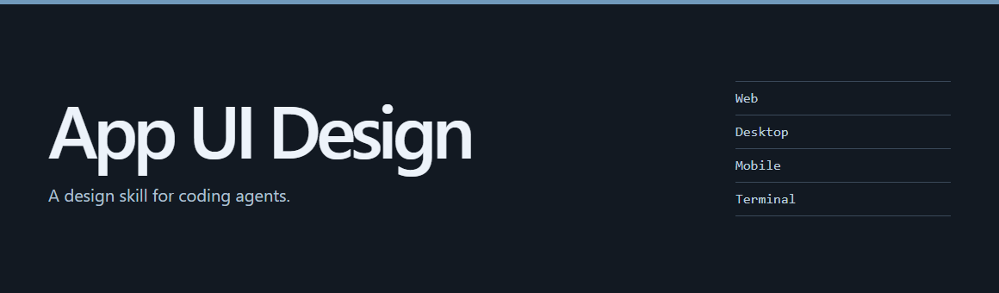
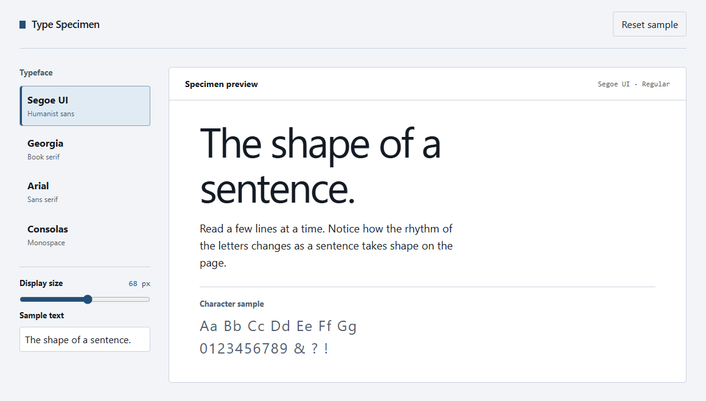
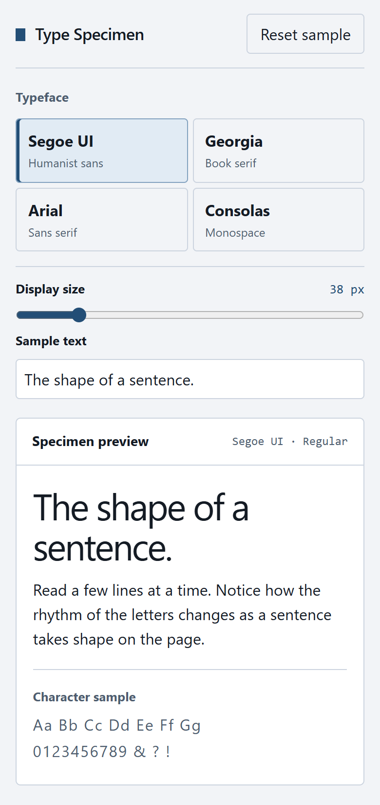

# App UI Design

A coding-agent skill for designing, polishing, and reviewing interfaces across web, desktop, mobile, and terminal applications.

[简体中文](README.zh-CN.md) · [Read the skill](skills/app-ui-design/SKILL.md) · [See the example](#example-type-specimen)

## Install

```sh
npx skills add https://github.com/Whitersir/app-ui-design --skill app-ui-design
```

Alternatively, copy [`skills/app-ui-design`](skills/app-ui-design) into a skill directory that your agent reads. Keep `SKILL.md` and `references/` together. In Codex, you can explicitly invoke `$app-ui-design` in a new request.

```text
$app-ui-design Polish this settings screen. Keep the existing layout and make keyboard focus easier to follow.
```

## How it works

| Task | What the skill does |
| --- | --- |
| Build or redesign | Choose a visual direction from the product and its content, then carry it through typography, spacing, components, and states. |
| Polish | Work within the existing visual system and check the affected flow. |
| Review | Inspect the result and report findings and proposed fixes in order of impact. |

The same workflow adapts to the interface. A web page needs viewport and keyboard checks. Desktop apps need resizable layouts and predictable focus. Mobile screens need touch, system insets, and software-keyboard checks. Terminal interfaces need a legible cell grid, key hints, and clear status.

## Example: Type Specimen

An interactive type tester with a font picker, size slider, and editable sample. At wide widths the controls sit next to the specimen. At phone widths the same controls reflow above the preview. Both images are browser captures of the included example.





To try it, download [`examples/type-specimen.html`](examples/type-specimen.html) and open it in a browser. It runs locally without a build step.
