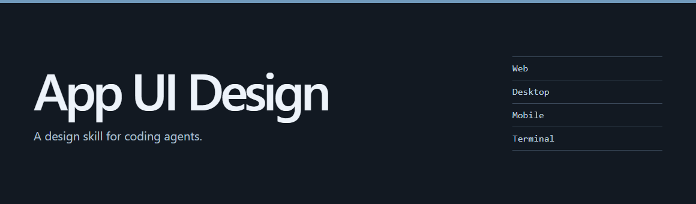
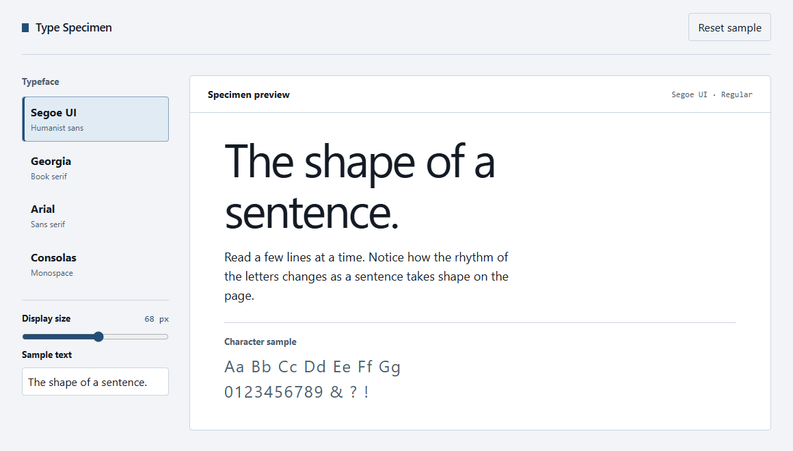
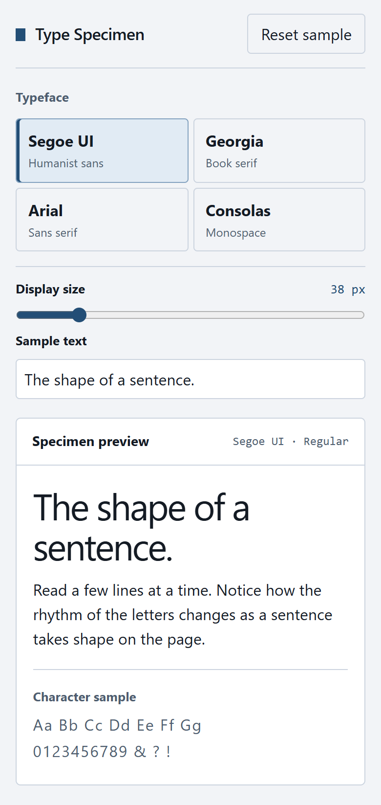

# App UI Design

一个为编程 Agent 编写的界面设计 Skill。新建、改版、打磨、审查都能使用。网页、桌面、手机和终端共用一个入口，各自按平台特点验证。

[English](README.md) · [查看技能](skills/app-ui-design/SKILL.md) · [查看示例](#示例字体试样工具)

## 安装

```sh
npx skills add https://github.com/Whitersir/app-ui-design --skill app-ui-design
```

也可以把 [`skills/app-ui-design`](skills/app-ui-design) 整个文件夹复制到编程 Agent 的技能目录，保留其中的 `SKILL.md` 和 `references/`。在 Codex 中可以显式调用 `$app-ui-design`。

```text
$app-ui-design 帮我打磨这个设置界面，保留现有布局，让键盘焦点更容易跟踪。
```

## 它怎么工作

| 任务 | 处理方式 |
| --- | --- |
| 新建或改版 | 从产品和内容里提炼方向，再落实到字体、间距、组件和界面状态。 |
| 局部打磨 | 沿用现有设计体系，检查本次改动涉及的流程。 |
| 只读审查 | 给出按影响排序的问题和修复建议。 |

网页版检查不同宽度和键盘操作，桌面版关注窗口缩放与焦点，手机版关注触控、安全区和软键盘，终端版关注字符栅格、按键提示和状态。

## 示例：字体试样工具

这是一个能切换字体、调整字号和编辑试样的交互示例。宽屏把控制区放在预览旁边，窄屏则把同一组操作放到预览上方。两张图都是仓库示例的实际浏览器截图。





下载 [`examples/type-specimen.html`](examples/type-specimen.html) 后直接用浏览器打开即可试用，无需构建。
